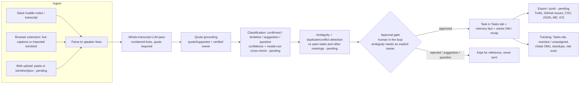

# PS-4 Meeting-to-Execution: technical explanation

HACKNOVA'26 problem statement 4, "Meeting-to-Execution Automation Agent". This page is the short technical explanation: the problem, the approach and workflow, the key decisions, how it is evaluated (with the real numbers and their limits), and where things live. For the demo itself see [ps4-demo-runbook](ps4-demo-runbook.md); for the numbers see [meeting-eval](../qa/meeting-eval.md).

**Status legend.** Plain statements describe code in the deployed tree. **[pending]** marks work that was in progress in parallel branches when this was written (the unified meeting pipeline, the review UI, Trello/GitHub export); each is named so you can check whether it has merged.

## 1. Problem and approach

Meetings produce commitments that vanish: owners are implied ("I'll take that"), dates are relative ("by Friday"), the same task is said twice with two dates, and ideas ("maybe we should...") are mistaken for promises. The agent has to read a transcript, extract only what was really committed, refuse to guess what was not said, ask a human where it is unsure, and push the approved result into the tools where work is tracked.

Approach in one paragraph: one pass over the **whole** transcript by an LLM that must quote its evidence; code, not the model, verifies the quotes, owners and dates; every item is classified (confirmed commitment, tentative, suggestion, open question) with a confidence and a reason; ambiguity (missing or ambiguous owner, duplicates, conflicts) is computed and surfaced; a human approves before anything becomes a task, a DM or a board card; approved work is tracked by the same task system that already chases owners.

## 2. Architecture and workflow



What exists today, stage by stage:

| Stage | Code | Notes |
|---|---|---|
| Ingest: Slack huddles | `server/src/meetings/index.ts` (`ingestHuddleFile`, `syncRecentHuddles`) | Inline huddle transcript lines or the huddle canvas; one record per saved file. |
| Ingest: extension | `extension/`, `ingestExtensionTranscript`, extension routes in `server/src/routes/meetings.ts` | Live captions or *Import transcript* (`.txt`, `.vtt`, `.srt`); token-authenticated, per-user. |
| Ingest: web upload | **[pending]** | Paste/upload on the Meetings page. |
| Whole-transcript pass | `analyze` in `meetings/index.ts` (final), `analyzeLiveMeeting` (live items) | Reads up to 400k characters, never a tail. Unified final pass **[pending]**: `meetings/analyze.ts`. |
| Grounding | `server/src/meetings/verify.ts` | `quoteSupported` (exact or fuzzy, anchored on the rarest word), `verifiedOwner`. |
| Classification | `analyzeLiveMeeting` | `kind`, `label`, `reason`, `quote`, `evidence` line numbers. Confidence and cross-check **[pending]**. |
| Ambiguity, duplicates, conflicts | **[pending]** (`meetings/detect.ts`) | Today the extractor only merges obvious restatements. |
| Approval gate | Today: nothing is DMed without an explicit "Send task DMs". Approve/reject states and auto-assign threshold **[pending]**. | |
| Task, memory, DMs | `manager/commitments.ts` (meeting tasks copied hourly), `rememberMeeting`, `sendMeetingTaskDms` | Tasks idempotent on `source_ref`; memory write scoped to the channel (public -> shared, private -> channel). |
| Export/push | **[pending]** (`docs/guide/task-export.md` on the export branch) | Trello cards, GitHub issues, CSV/JSON/MD/ICS. Jira: read-only sync only ([jira-plan](jira-plan.md)). |
| Tracking | `server/src/manager/*`, console Tasks tab | Overdue/unassigned views, chase (3 nudges per task, 3 DMs/day each), standups, risk scan. |

## 3. Key implementation decisions

1. **Quote-verified extraction.** A model may invent tasks. Every task and decision must carry a quote, and `quoteSupported` checks it against the transcript (80% of the words inside one window anchored on the rarest word, so ASR noise is tolerated and invention is not). Today an item without a supporting quote is dropped; the unified pass keeps it as "unverified" so the reviewer can see what was discarded, and never turns it into a task automatically.
2. **Never guess owners or dates.** The prompt forbids it, and code enforces it: an owner is accepted only if that person is a participant or is named in the text (`verifiedOwner`); relative dates are resolved against the meeting's start time and unresolved phrases stay as text. Missing means missing, shown as "Needs owner" / "Set date".
3. **Commitment vs suggestion is a first-class label**, not a score threshold. Four labels, one-line reason, line-number evidence. Hypotheticals and past actions ("I already sent it") produce nothing.
4. **Approval before notification.** An LLM's guess at an owner must never message a real person. Today DMs go out only from an explicit "Send task DMs" click. The unified flow adds per-item approve/reject and an admin choice between approval-required and auto-assign above a confidence threshold **[pending]**; items with a missing owner, a duplicate or a conflict are always held.
5. **Whole transcript, one pass.** Summaries and tasks come from the full text (chunked with overlap only beyond 60k characters in the unified pass), not from rolling live fragments, so a decision reversed at minute 40 is seen as reversed. Live notes during a call carry only topics and open questions.
6. **Scope and privacy model.** Meetings inherit the visibility of where they came from: public channel -> everyone, private channel -> its members, extension upload -> its uploader (and admins), DM huddles never listed. Memory writes follow the same tags. Background memory is given to the model only to understand names and references; it can never create an item.
7. **Idempotency.** Extension uploads replace by `externalId`; commitments are unique on `source_ref`; task ids are stable across re-analysis (matched by title, `assignTaskIds`; carrying approvals and edits forward is **[pending]**); pushes to a board happen once per task per board **[pending]**.
8. **Auditability.** Each item stores its quote, evidence lines, reason and who approved it and when; pushes are logged in `integration_pushes` **[pending]**; every task status change rewrites its memory fact and supersedes the old one, so history is kept.
9. **Fail loudly.** A failed analysis marks the meeting `failed` with the reason (and a Retry) instead of an empty success.

## 4. Data model summary

- `meetings`: id, source file id (unique), channel, platform, owner, title, transcript, summary, `tasks` (jsonb), `decisions`, participants, status (`processing | ready | failed`), timestamps.
- Items: the unified shape is `MeetingItem` = `{id, itemType (task|decision|question), title, description, assigneeId, assigneeName, dueDate, priority, kind, label, confidence, reason, quote, evidence[], unverified, followUp, approval (proposed|approved|rejected), approvedBy, approvedAt, ambiguity{ownerMissing, ownerAmbiguous, ownerCandidates, dueMissing, duplicateOf[], conflicts[]}, commitmentId, notification, externalRefs[]}` **[pending]**. The deployed tree stores the legacy subset (`id, title, description, assigneeName, assigneeId, dueDate`) plus Jira refs.
- `commitments`: the task (owner, text, due, source type/ref, scope tag, status `open | in_progress | overdue | done | dropped`, nudge counters), mirrored as a memory fact.
- `meeting_task_notifications`: DM delivery history per task and recipient (`sent | acknowledged | declined | failed`).
- `memories`, `entities`: scoped team memory the meeting writes into.

## 5. Evaluation

**Method.** `server/test/meeting-eval/` holds 12 hand-written gold meetings (57-73 turns each; 4 AMI-style design-team meetings, 3 QMSum-style excerpts, 5 synthetic business meetings) with planted relative dates, implicit owners, suggestions, open questions, duplicate pairs, due and owner conflicts, hypotheticals, past actions and two hard cases (pronoun owner; dates relative to a stated date). `scripts/meeting-eval.ts` runs the real model through a thin adapter and scores task precision/recall/F1 (token-Jaccard of titles at least 0.5), owner accuracy, exact due date, the 4-label confusion matrix, decision P/R, duplicate and conflict detection, hallucination rate (using the repo's own `quoteSupported`), approval safety and latency. Loaders for the real AMI and QMSum corpora read a local copy and never fetch anything. A deterministic test (`bun test test/meeting-eval`) guards the fixtures, the scorer and `baseline.json` in CI without calling a model.

**Results** (Vertex `gemini-3.5-flash`, one run, 2026-10-24, the live analyzer that is deployed; full table and confusion matrix in [meeting-eval](../qa/meeting-eval.md)):

| Metric | Value |
|---|---|
| Task precision / recall / F1 | 79.2% / 75.0% / 77.0% |
| Owner accuracy (matched tasks) | 98.2% |
| Due-date exact match (gold has a date) | 96.4% |
| Classification accuracy (4 labels) | 89.5% |
| Decision F1 | 93.7% |
| Duplicate / conflict / grounding / approval metrics | n/a: this analyzer does not emit those fields |
| Latency per meeting (mean / p95) | 5.8 s / 8.9 s |

Preview of the unmerged unified pass on the same fixtures: classification 96.4%, duplicate detection 100% with 0% false duplicates, hallucination 0%, no crashed runs, but **conflict detection 0%** (the extractor collapses "Friday, then Monday" into one task before the checker sees it) and lower task precision (71.4%). It is labelled a preview in the eval doc and will be re-measured after merge.

**Limitations, plainly.**
- 12 meetings, written by us in the style of the corpora, not drawn from them; the gold is a regression gate and a sanity check, not a benchmark claim. Real AMI/QMSum give only decision/action proxies (no owners or dates).
- One run at temperature 0; models still vary by a few points between runs (the same fixtures scored 100% and 78% task precision on one meeting across two runs). Differences below about five points are noise.
- Strict title matching undercounts correct but differently-worded tasks and the live analyzer crashed on about one meeting in six on the first attempt (a reply where an item had no `title` failed schema validation); the unified pass removed that failure mode in the preview.
- The hardest remaining cases are hedged commitments read as firm, and conflicts the model resolves silently.

## 6. Security and privacy

Visibility follows source scope (above). Tokens: Slack/OAuth/board credentials encrypted at rest with AES-256-GCM (`ENCRYPTION_KEY`), API and extension tokens stored hashed and shown once; extension uploads authenticate by token, not cookie. Prompt-injection posture: the transcript is treated as data; the model has no tools in the extraction pass; any value that reaches a DM, a task or a card passes through code checks (verified owner, safe titles, escaped Slack text), and a quote that is not in the transcript removes an item. Board exports neutralise spreadsheet-formula cells **[pending]**. Demo data is isolated by markers and removed by `scripts/reset-demo.ts`, which refuses to run without `--yes`.

## 7. How to run

```bash
cd server && bun install
bun test test/meeting-eval                  # deterministic gate (needs DATABASE_URL on a throwaway pgvector db for demo-kit.test.ts)
bun --env-file=../.env run scripts/meeting-eval.ts            # real-model eval, prints a table (add --write to refresh the docs and baseline)
bun run scripts/seed-demo.ts --yes && bun run scripts/seed-demo-meetings.ts --yes
bun run scripts/reset-demo.ts --yes         # remove only demo-marked data
```

## 8. Repo map

| Path | What |
|---|---|
| `server/src/meetings/` | `index.ts` ingest, analysis, DMs, memory write; `verify.ts` quote grounding; `suggest.ts` assignee suggestions |
| `server/src/manager/` | commitments (tasks), chase, standup, risks |
| `server/src/routes/meetings.ts` | console and extension HTTP routes |
| `extension/` | Chrome side panel (live notes, import, items, suggest) |
| `web/pages/meetings.tsx`, `web/pages/tasks.tsx` | console pages |
| `server/test/meeting-eval/` | gold fixtures, scorer (`lib.ts`), adapter (`adapter.ts`), baseline, deterministic tests |
| `server/scripts/meeting-eval.ts`, `meeting-eval-loaders/` | real-model runner; offline AMI and QMSum loaders |
| `server/scripts/seed-demo-meetings.ts`, `reset-demo.ts` | demo data and clean reset |
| `docs/demo/` | sample transcripts and the presenter checklist |
| `docs/qa/meeting-eval.md`, `docs/guide/ps4-*.md` | evaluation report, this page, the runbook |
